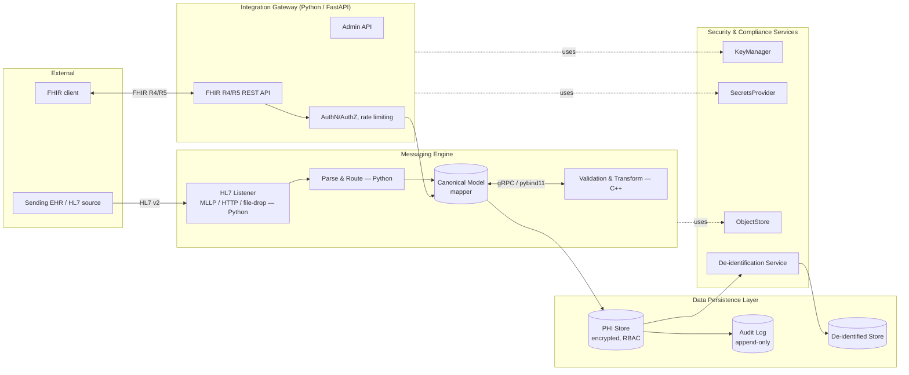
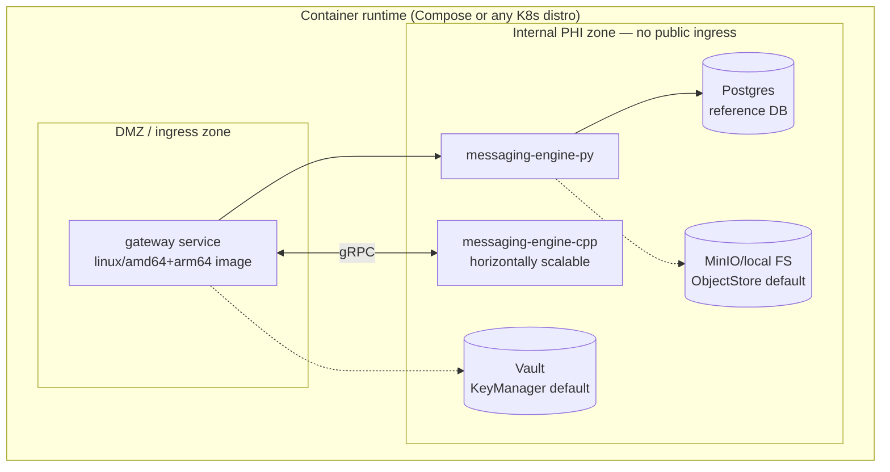

# Architecture

**Status:** Draft, planning phase — no code exists against this yet.

## 1. Principles

- **Platform-agnostic from day one.** No OS-specific assumption, no cloud-vendor SDK in core logic. Containers are the deployment unit everywhere.
- **One canonical model, not pairwise translators.** See [ADR-001](DECISIONS.md#adr-001) — this is the single highest-leverage decision in the system.
- **Pluggable infrastructure.** `KeyManager`, `ObjectStore`, `MessageBus`, and the DB access layer are interfaces with a self-hosted reference implementation, not a hardcoded vendor.
- **Confidential by default.** No outbound telemetry/error-reporting/log-sink to third-party SaaS unless a BAA exists and it's explicitly turned on.
- **Language boundary chosen by measurement, not preference.** Python owns orchestration and the API surface; C++ owns high-throughput validation/transform; the boundary between them defaults to gRPC and only narrows to in-process pybind11 where latency data justifies it.

## 2. Component view

## 3. Deployment view

The internal PHI zone is not reachable from outside the container network directly — only the Gateway is exposed, and only the Gateway terminates external TLS.

## 4. Technology stack

| Concern | Choice | Rationale |
|---|---|---|
| Orchestration / API | Python 3.12, FastAPI | Async-friendly, strong FHIR/HL7 library ecosystem |
| High-throughput validate/transform | C++20 | Raw parsing/validation throughput at scale |
| Python↔C++ boundary | gRPC (default), pybind11 (fallback) | See [ADR-002](DECISIONS.md#adr-002) |
| Reference DB | PostgreSQL | Mature, strong encryption/RBAC support, not a hard dependency (abstracted) |
| Reference KeyManager | HashiCorp Vault (self-hosted) | Self-hostable, avoids cloud KMS lock-in |
| Reference ObjectStore | MinIO / local FS | S3-compatible without requiring AWS |
| Reference MessageBus | Kafka or RabbitMQ (config-selectable) | Only introduced if a phase actually needs async decoupling |
| Observability | OpenTelemetry | Vendor-neutral traces/metrics; export target configurable and off by default for third parties |
| Packaging | Docker multi-stage, multi-arch (OCI) | Runs identically on any Kubernetes distro or bare Compose |

## 5. Python ↔ C++ boundary — detail

**Default: gRPC.** The C++ validation/transform service runs as an independent process (or set of replicas). The Python Messaging Engine calls it over a gRPC service contract covering: `ValidateHL7Message`, `ValidateFHIRResource`, `TransformToCanonical`, `TransformFromCanonical`. This keeps deploy/scale lifecycles fully decoupled — the C++ service can be redeployed or scaled without touching the Python gateway.

**Fallback: pybind11.** Only adopted per-service if measured gRPC round-trip latency is unacceptable for that service's throughput target. Couples the build toolchain (C++ compiler matching Python's target platform) — deliberately narrow use, not a default.

Actual `.proto` contracts and pybind11 bindings are Phase 1 build artifacts, not written at planning time — described here only at the interface-shape level so the boundary decision is reviewable before code exists.

## 6. Data flow — HL7 ingestion to FHIR read

1. EHR sends HL7 v2 ADT message over MLLP.
2. HL7 Listener accepts, hands to Parser.
3. Parser validates structure; C++ Validator confirms segment/field conformance.
4. Valid message maps HL7 v2 → canonical model.
5. Canonical instance persists to PHI store; audit entry written.
6. De-identification service asynchronously produces a Safe Harbor copy into the de-identified store.
7. A FHIR client later `GET`s the resource; Gateway authenticates/authorizes, reads canonical instance, maps canonical → FHIR R4, returns it.

Every arrow in this flow is covered by a functional requirement in [SRS.md §5](SRS.md#5-functional-requirements).

## 7. What's deliberately not decided here

- Exact `.proto` message shapes — Phase 1.
- Exact DB schema/migrations — Phase 1, sketched in [DESIGN.md](DESIGN.md).
- Kubernetes manifests vs. Helm chart vs. Compose-only for v1 — doesn't block architecture, decided when a real deployment target is confirmed.
