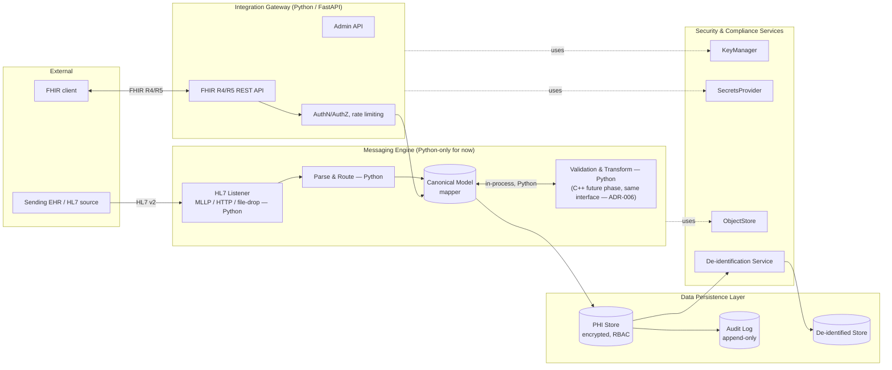
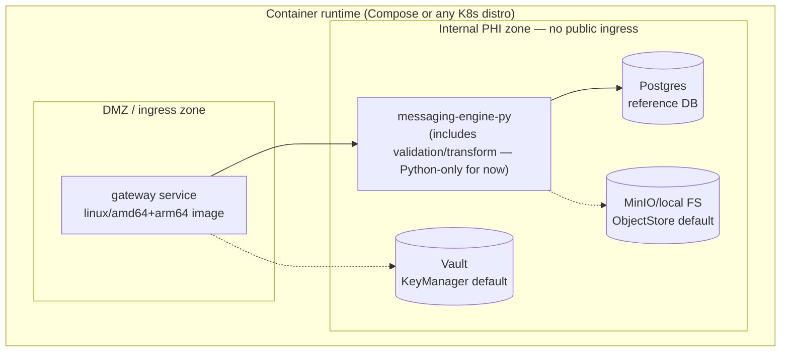

# Architecture

**Status:** Draft, planning phase — no code exists against this yet.

## 1. Principles

- **Platform-agnostic from day one.** No OS-specific assumption, no cloud-vendor SDK in core logic. Containers are the deployment unit everywhere.
- **One canonical model, not pairwise translators.** See [ADR-001](DECISIONS.md#adr-001) — this is the single highest-leverage decision in the system.
- **Pluggable infrastructure.** `KeyManager`, `ObjectStore`, `MessageBus`, and the DB access layer are interfaces with a self-hosted reference implementation, not a hardcoded vendor.
- **Confidential by default.** No outbound telemetry/error-reporting/log-sink to third-party SaaS unless a BAA exists and it's explicitly turned on.
- **Language boundary chosen by measurement, not preference.** Python owns orchestration and the API surface. C++ high-throughput validation/transform is a **future phase, not part of the current build** (see [ADR-006](DECISIONS.md#adr-006)) — validation/transform runs in Python for now, in its own module boundary so a C++ service can be swapped in later behind the same interface without a redesign.

## 2. Component view

## 3. Deployment view

The internal PHI zone is not reachable from outside the container network directly — only the Gateway is exposed, and only the Gateway terminates external TLS.

## 4. Technology stack

| Concern | Choice | Rationale |
|---|---|---|
| Orchestration / API | Python 3.12, FastAPI | Async-friendly, strong FHIR/HL7 library ecosystem |
| Validation / transform (current build) | Python, same process as Messaging Engine | Python-only scope for now — see [ADR-006](DECISIONS.md#adr-006) |
| High-throughput validate/transform | **Future phase — C++20, not built now** | Deferred; interface boundary designed in so it can be added later, see [ADR-006](DECISIONS.md#adr-006) |
| Python↔C++ boundary (future) | gRPC (default), pybind11 (fallback) | Design reserved for the future C++ phase — [ADR-002](DECISIONS.md#adr-002) |
| Reference DB | PostgreSQL | Mature, strong encryption/RBAC support, not a hard dependency (abstracted) |
| Reference KeyManager | HashiCorp Vault (self-hosted) | Self-hostable, avoids cloud KMS lock-in |
| Reference ObjectStore | MinIO / local FS | S3-compatible without requiring AWS |
| Reference MessageBus | Kafka or RabbitMQ (config-selectable) | Only introduced if a phase actually needs async decoupling |
| Observability | OpenTelemetry | Vendor-neutral traces/metrics; export target configurable and off by default for third parties |
| Packaging | Docker multi-stage, multi-arch (OCI) | Runs identically on any Kubernetes distro or bare Compose |

## 5. Python ↔ C++ boundary — future phase, not current scope

Per [ADR-006](DECISIONS.md#adr-006), the current build is Python-only. Validation/transform lives in its own module inside the Python Messaging Engine, called with plain in-process function calls — not a network boundary — for now.

The design below is kept documented so the future C++ phase has a clear target, not because it's being built now:

**Default: gRPC.** A future C++ validation/transform service would run as an independent process (or set of replicas), called over a gRPC service contract covering: `ValidateHL7Message`, `ValidateFHIRResource`, `TransformToCanonical`, `TransformFromCanonical`. This would keep deploy/scale lifecycles fully decoupled — the C++ service could be redeployed or scaled without touching the Python gateway.

**Fallback: pybind11.** Would only be adopted per-service if measured gRPC round-trip latency proved unacceptable for that service's throughput target.

No `.proto` contracts or bindings exist yet, and won't until the C++ phase is actually scheduled.

## 6. Data flow — HL7 ingestion to FHIR read

1. EHR sends HL7 v2 ADT message over MLLP.
2. HL7 Listener accepts, hands to Parser.
3. Parser validates structure; C++ Validator confirms segment/field conformance.
4. Valid message maps HL7 v2 → canonical model.
5. Canonical instance persists to PHI store; audit entry written.
6. De-identification service asynchronously produces a Safe Harbor copy into the de-identified store.
7. A FHIR client later `GET`s the resource; Gateway authenticates/authorizes, reads canonical instance, maps canonical → FHIR R4, returns it.

Every arrow in this flow is covered by a functional requirement in [SRS.md §5](SRS.md#5-functional-requirements).

## 7. What's deliberately not decided here

- Exact `.proto` message shapes — Phase 1.
- Exact DB schema/migrations — Phase 1, sketched in [DESIGN.md](DESIGN.md).
- Kubernetes manifests vs. Helm chart vs. Compose-only for v1 — doesn't block architecture, decided when a real deployment target is confirmed.
