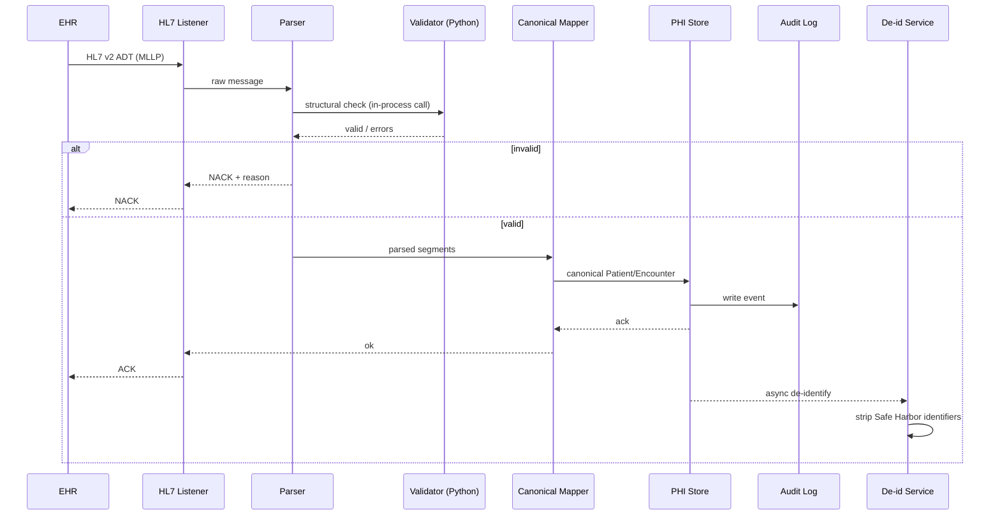
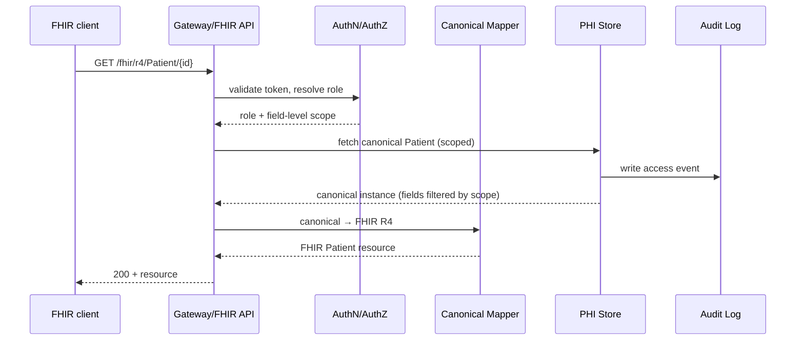

# Detailed design

**Status:** Draft, planning phase. Interfaces below are described at the signature/contract level to make the design reviewable — they are not implementation, and no source files exist yet.

## 1. Module breakdown

### Integration Gateway (Python/FastAPI)

| Module | Responsibility |
|---|---|
| `gateway.api.fhir` | FHIR R4/R5 REST routes, resource (de)serialization |
| `gateway.api.admin` | Routing config, health/readiness, metrics endpoints |
| `gateway.auth` | AuthN (token/mTLS) and AuthZ (RBAC enforcement), shared by both API groups |
| `gateway.ratelimit` | Per-client throttling |

### Messaging Engine

| Module | Language | Responsibility |
|---|---|---|
| `messaging.hl7.listener` | Python | MLLP/HTTP/file-drop ingestion |
| `messaging.hl7.parser` | Python | Structural parse, segment extraction |
| `messaging.hl7.router` | Python | Routes by message type / configured rules |
| `messaging.canonical.mapper` | Python | HL7 v2 ↔ canonical ↔ FHIR mapping (data in [DATA_MODEL.md](DATA_MODEL.md)) |
| `messaging.validator` | Python | Structural + terminology validation, transform. In-process for now; kept as its own module so a future C++ service can replace it behind the same call boundary without touching callers ([ADR-006](DECISIONS.md#adr-006)) — **C++ is a future implementation pipeline, not current scope.** |

### Persistence

| Module | Responsibility |
|---|---|
| `persistence.phi_repo` | PHI store reads/writes, field-level filtering by role |
| `persistence.audit_log` | Append-only audit writes; no update/delete code path exists |
| `persistence.deid_repo` | De-identified store reads/writes |

### Security & Compliance Services

| Module | Responsibility |
|---|---|
| `security.keymanager` | Interface + Vault reference implementation |
| `security.secrets` | Interface + Vault reference implementation |
| `security.objectstore` | Interface + MinIO/local-FS reference implementation |
| `security.deid` | Safe Harbor de-identification pipeline |

## 2. Sequence — HL7 ADT ingestion

## 3. Sequence — FHIR read with RBAC

## 4. Error handling & ACK/NACK strategy

- Structural failures (malformed HL7, unparseable segments) → immediate NACK, message routed to dead-letter store, never silently dropped ([FR-1.6](SRS.md#51-hl7-v2-ingestion)).
- Transform failures (valid HL7, no canonical mapping rule) → logged with source message ID + failing field ([FR-2.3](SRS.md#52-canonical-transformation)), routed to dead-letter store, does not crash the listener process.
- FHIR write failures → `OperationOutcome` per FHIR spec, no partial writes (transaction boundary at the canonical-mapper level).

## 5. Pluggable infrastructure — interface shapes

Interfaces only; concrete adapters (Vault, MinIO, Postgres) are Phase 1 implementation.

- **`KeyManager`** — `get_key(key_id) -> bytes`, `rotate_key(key_id) -> key_id`
- **`SecretsProvider`** — `get_secret(name) -> str`, backed by Vault in the reference implementation, never by plaintext config
- **`ObjectStore`** — `put(bucket, key, data)`, `get(bucket, key) -> data`, `delete(bucket, key)`
- **`MessageBus`** (only introduced when a phase needs async decoupling) — `publish(topic, message)`, `subscribe(topic, handler)`

Each has exactly one reference implementation named in [ARCHITECTURE.md §4](ARCHITECTURE.md#4-technology-stack) and is swappable via config, never imported directly by business logic.

## 6. Testing strategy (applies once build starts)

- **Unit tests** — per module, synthetic fixtures only.
- **Contract tests** — gRPC boundary between Python and C++ validator, run on every change to either side.
- **Integration tests** — full HL7-in → FHIR-out round trip against synthetic ADT/ORM/ORU fixtures.
- **Compliance tests** — audit log completeness (every PHI access produces exactly one entry), de-identification completeness (no Safe Harbor identifier category present in de-identified output).
- All fixtures are synthetic. No real PHI enters any test path, ever ([NFR-7](SRS.md#6-non-functional-requirements)).

## 7. Configuration

A single typed config object per service, sourced from environment variables and/or a mounted config file — no service reads infrastructure secrets from anywhere except through `SecretsProvider`. Config selects which reference implementation backs each pluggable interface (e.g. `KEYMANAGER_BACKEND=vault`).
